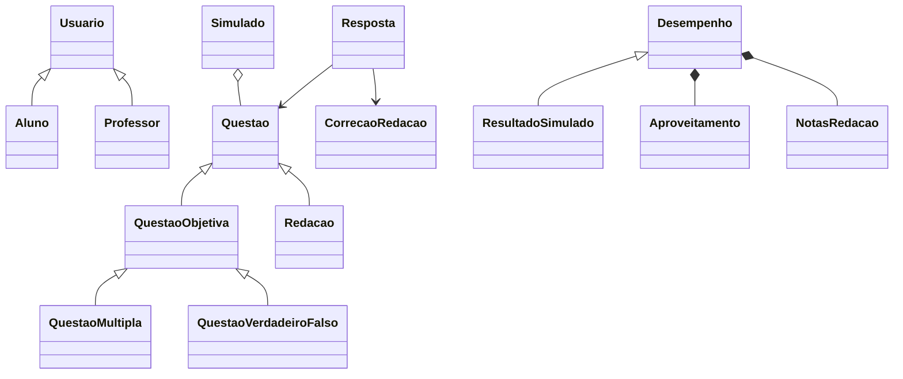

# Questões de Concurso

Sistema web para estudar para concursos e vestibulares. O professor cadastra questões, monta simulados e corrige redações. O aluno responde as questões, faz os simulados e acompanha o seu desempenho.

Feito em Python com Flask e SQLite.

## Funcionalidades

**Aluno**

- Criar conta e fazer login
- Responder questões e ver na hora se acertou
- Fazer simulados e ver o resultado de cada questão
- Escrever redações no modelo do ENEM e receber nota e comentário do professor
- Ver o desempenho geral e por disciplina

**Professor**

- Cadastrar, editar e excluir questões de múltipla escolha, verdadeiro ou falso e redação
- Montar simulados escolhendo as questões
- Corrigir redações pelas cinco competências do ENEM
- Ver o desempenho de cada aluno e o resultado dos simulados

## Tecnologias

- Python 3.9+
- Flask
- SQLite (com o módulo `sqlite3`, sem ORM)
- Jinja2 e CSS
- pdoc para gerar a documentação

## Como rodar

```bash
git clone https://github.com/iszxsz/Questoes-Concurso.git
cd Questoes-Concurso

python -m venv .venv
.venv\Scripts\activate        # no Windows
source .venv/bin/activate     # no Linux/macOS

pip install -r requirements.txt
python seed.py
python app.py
```

Depois é só abrir `http://127.0.0.1:5000` no navegador.

O `seed.py` cria o banco com alguns dados de exemplo (questões, simulados e uma redação para corrigir). Ele apaga o banco antes, então tudo que foi cadastrado se perde.

### Contas de teste

| Perfil | E-mail | Senha |
| --- | --- | --- |
| Professor | professor@teste.com | 123456 |
| Aluno | aluno@teste.com | 123456 |

## Testes

Os testes ficam na pasta `tests/` e usam um banco separado (`teste.db`). Para rodar um deles:

```bash
python -m tests.test_simulado
```

Para rodar todos no PowerShell:

```powershell
Get-ChildItem tests\test_*.py | ForEach-Object { python -m "tests.$($_.BaseName)" }
```

## Documentação

As classes e métodos têm docstrings. Para gerar a documentação em HTML:

```bash
pdoc src -o docs/html
```

## Estrutura

```text
Questoes-Concurso/
├── app.py            inicia a aplicação
├── seed.py           cria o banco com dados de exemplo
├── src/
│   ├── database.py   conexão e criação das tabelas
│   ├── controllers/  rotas
│   └── models/       classes e regras do sistema
├── templates/        páginas HTML
├── static/           CSS
└── tests/            testes
```

## Classes



- `Usuario`, `Aluno` e `Professor`: login, cadastro e senha
- `Questao`: classe abstrata com o que toda questão tem (enunciado, disciplina, banca e ano)
- `QuestaoMultipla` e `QuestaoVerdadeiroFalso`: questões com gabarito, corrigidas automaticamente
- `Redacao`: corrigida pelo professor
- `Resposta`: o que o aluno respondeu
- `Simulado`: um conjunto de questões
- `Desempenho` e `Aproveitamento`: acertos, erros e percentual do aluno

## Programação Orientada a Objetos

### Classes e objetos

Cada parte do sistema virou uma classe em `src/models/`: usuário, questão, resposta, simulado, desempenho etc. Os dados que vêm do banco são transformados em objetos, por exemplo com `Questao.de_linha()` e `Resposta.de_linha()`.

### Encapsulamento

Os atributos que não devem ser mudados de fora são privados (com `__`) e só podem ser lidos por `@property`.

- `Aproveitamento` guarda `__total` e `__acertos`. Para mudar esses valores só existe o método `registrar()`, e `erros` e `percentual` são calculados a partir deles.
- `CorrecaoRedacao` valida as notas no construtor e depois não deixa alterar. A `nota` final não é guardada, é sempre a soma das competências.
- `Resposta` só muda de situação pelo método `registrar_correcao()`.
- Métodos de validação internos também são privados, como `__validar_gabarito()` em `QuestaoObjetiva` e `__validar_alternativas()` em `QuestaoMultipla`.
- Atributos com um `_` só (protegidos) são usados quando a subclasse precisa acessar, como `_gabarito` em `QuestaoObjetiva` e `_geral` em `Desempenho`.

### Herança

- `Aluno` e `Professor` herdam de `Usuario` (nome, e-mail, senha e login).
- `QuestaoObjetiva` e `Redacao` herdam de `Questao`. `QuestaoMultipla` e `QuestaoVerdadeiroFalso` herdam de `QuestaoObjetiva`, que já traz o gabarito e a correção automática.
- `ResultadoSimulado` herda de `Desempenho` e reaproveita todo o cálculo de acertos, só que considerando apenas as respostas do simulado.
- `AuthController`, `AlunoController` e `ProfessorController` herdam de `Controller`, que faz o controle de acesso das rotas.

### Abstração

`Questao` é uma classe abstrata (usa `ABC`) com os métodos `validar_resposta()` e `corrigir()` marcados com `@abstractmethod`. Não dá para criar uma `Questao` direto, só uma das subclasses. `QuestaoObjetiva` também é abstrata, porque deixa o método `opcoes()` para as filhas.

### Polimorfismo

O método `corrigir()` existe em todas as questões, mas cada uma faz de um jeito:

- `QuestaoObjetiva` compara a resposta com o gabarito e devolve `correta` ou `errada`.
- `Redacao` só confere o tamanho do texto e devolve `pendente`, porque quem corrige é o professor.

Assim, `Resposta.registrar()` e `Simulado.responder()` chamam `questao.corrigir()` sem precisar saber qual é o tipo da questão.

## Regras

- Múltipla escolha tem de 2 a 5 alternativas.
- Verdadeiro ou falso tem gabarito `V` ou `F`.
- Questão que já foi respondida não pode ser excluída.
- A redação precisa ter pelo menos 300 caracteres.
- Cada competência da redação vale 0, 40, 80, 120, 160 ou 200, e a nota final é a soma (até 1000).
- O aluno só pode fazer cada simulado uma vez e precisa responder todas as questões.
- Só alunos podem se cadastrar pelo site. Professores são criados direto no banco.

## Limitações até o momento

- Não tem recuperação de senha.
- Não tem migração de banco: se mudar as tabelas, precisa rodar o `seed.py` de novo.
- O Flask está em modo de depuração, então não é para usar em produção.
